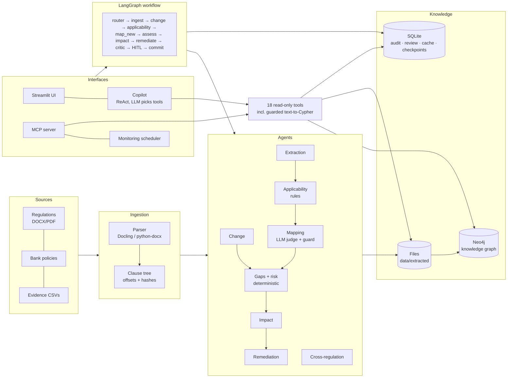

# RegIntel: Agentic Regulatory Compliance Intelligence

> ET AI Hackathon: Agentic Edition · Banking / financial regulations
>
> **Live demo:** [your Streamlit Cloud URL] · **Video:** [link] · **Slides:** [link]

RegIntel keeps a bank's regulations, obligations, controls, evidence and gaps linked in one **versioned
knowledge graph**, maintained by **AI agents**. When a regulation changes, it finds exactly what changed,
re-assesses only what is affected, quantifies the exposure, drafts remediation and asks a human to approve
before anything high-risk is committed.

```
Regulation → Obligation → Applicability → Control → Evidence → Test → Gap → Remediation → Monitoring
```

> **Data disclaimer:** all bank data (Bharat Unity Bank, its policies, controls and evidence) is **synthetic**.
> Regulation texts are **paraphrased demo excerpts** with illustrative clause numbers, not official texts.
> The KYC amendment used in the demo is **hypothetical**.

---

## Contents
1. [Features](#features) · 2. [Architecture](#architecture) · 3. [Tech stack](#tech-stack) ·
4. [Quick start](#quick-start-5-minutes) · 5. [Environment setup](#environment-setup) ·
6. [Rebuild the pipeline from scratch](#rebuild-the-pipeline-from-scratch) · 7. [Running the system](#running-the-system) ·
8. [API documentation](#api-documentation) · 9. [Evaluation](#evaluation) · 10. [Deployment](#deployment) ·
11. [Project structure](#project-structure) · 12. [Troubleshooting](#troubleshooting) · 13. [Roadmap](#roadmap)

---

## Features

| Problem-statement feature | How RegIntel does it |
|---|---|
| Regulatory intelligence and ingestion | DOCX/PDF → clause tree with exact character offsets and content hashes |
| Regulatory change intelligence | Clause alignment (hash + similarity + Hungarian matching); change classified as NEW / DELETED / TIGHTENED / RELAXED / CLARIFICATION / EDITORIAL |
| Obligation extraction | Structured (actor, modality, action, parameters, topics); every quote verified against the source |
| Bank control-framework understanding | Policy clauses → structured controls (type, nature, frequency, owner, systems, parameters) |
| Regulation-to-control mapping | Hybrid retrieval (BM25 + embeddings + topic) → LLM judge (FULL / PARTIAL / NONE + missing elements) → deterministic parameter check |
| Control effectiveness and evidence assessment | Pandas test procedures over evidence files (exception rate vs tolerance) |
| Gap identification | 6 types: unmapped, partial coverage, design gap, operating failure, missing evidence, stale control |
| Risk-based prioritisation | Deterministic formula: severity × inherent risk × weakness × urgency × blast radius |
| Remediation recommendations | Pattern-guided LLM plans, automatic checks (owner, deadline, regulatory parameter), one self-revision |
| Autonomous impact analysis | Change → obligations → controls → owners / systems / evidence / tests → gaps → customer exposure, plus a grounded executive summary |
| What-if | `coverage_if_control_removed`; exposure re-test at the regulatory threshold |
| Cross-regulation intelligence and contradiction detection | Candidate pairs across regulations and policies → CONFLICT / OVERLAP / STRICTER / RELATED, with resolution and harmonised obligation |
| Ongoing monitoring | Regulation and evidence watchers, scheduled re-tests, KRIs with breach/recovery events |
| Human in the loop | HIGH/CRITICAL gaps pause the workflow; approve or reject in the UI or CLI |
| Explainability and audit | Exact source quotes, append-only audit log, step-by-step agent trace |
| Interoperability | MCP server exposing all read-only tools to any MCP client |

---

## Architecture



**Design principles**
1. **Traceable:** every LLM quote is verified against the source text (exact offsets). Unverified results are rejected or sent to review.
2. **LLMs propose; code and humans decide:** LLMs never create IDs, timestamps or risk scores. Routing between agents is deterministic. HIGH/CRITICAL gaps need human approval.
3. **The system of record is protected:** Neo4j is written only at `commit`. Cypher written by an LLM or user goes through a three-layer read-only guard.
4. **Efficient:** deterministic code where possible, LLM response cache, task-based routing between a small and a large model, re-processing only of changed clauses.

**Where LLMs are used:** obligation and control extraction, change classification, mapping judgement, impact
summary, remediation drafting, cross-regulation judgement, Copilot tool selection, text-to-Cypher. Everything
else (routing, applicability, evidence tests, gap rules, risk scoring, guards) is plain code.

---

## Tech stack

| Layer | Technology |
|---|---|
| LLMs | Google Gemini 2.5 Flash / Flash-Lite (free tier, OpenAI-compatible endpoint); Groq, Ollama, OpenAI, Anthropic supported through config |
| Structured output | Instructor + Pydantic v2 |
| Orchestration | LangGraph (with SQLite checkpointer for human review that survives restarts) |
| Retrieval | BM25 (`rank-bm25`) + `BAAI/bge-small-en-v1.5` embeddings (optional) + topic bonus, fused by rank |
| Knowledge graph | Neo4j 5 (Desktop locally, AuraDB Free in the cloud) |
| Operational store | SQLite (audit log, runs, review queue, LLM cache, KRI snapshots) |
| Parsing | Docling (optional), python-docx, PyMuPDF |
| UI | Streamlit |
| Interoperability | Model Context Protocol (official Python SDK, FastMCP, stdio) |
| Scheduling | APScheduler 3.x |
| Language | Python 3.11+ |

---

## Quick start (5 minutes)

The repository includes the processed demo data (`data/parsed`, `data/extracted`, evidence, and a seeded LLM
cache), so the UI works **without rebuilding anything, without Neo4j and mostly without LLM calls**.

```bash
git clone [repo-url] regintel && cd regintel
python -m venv .venv
# Windows (Git Bash): source .venv/Scripts/activate   |   macOS/Linux: source .venv/bin/activate
pip install -r requirements.txt
pip install -e . --no-deps            # makes `python -m regintel...` commands available
cp .env.example .env                  # then add GOOGLE_API_KEY (needed for Copilot and new runs)
streamlit run streamlit_app.py        # http://localhost:8501
```

In the sidebar, switch **"Write results to Neo4j"** off if you haven't set up Neo4j.

**Full local install** (Docling, local embeddings, MCP, tests):
```bash
pip install -e ".[ml,mcp,dev]"
```

---

## Environment setup

Copy `.env.example` to `.env`. Only `GOOGLE_API_KEY` is needed for LLM features.

| Variable | Required | Default | Purpose |
|---|---|---|---|
| `GOOGLE_API_KEY` | For LLM features | – | Free key from [Google AI Studio](https://aistudio.google.com) |
| `GROQ_API_KEY`, `OPENAI_API_KEY`, `ANTHROPIC_API_KEY` | No | – | Alternative providers (set in `config/models.yaml`) |
| `NEO4J_URI` / `NEO4J_USER` / `NEO4J_PASSWORD` | No (needed for graph tools) | `bolt://localhost:7687` / `neo4j` / `regintel_pass` | Neo4j Desktop or AuraDB (`neo4j+s://...`) |
| `SQLITE_PATH` | No | `data/regintel.db` | Operational database (created automatically) |
| `EMBEDDING_BACKEND` | No | `auto` | `auto` (local BGE if installed), `local`, `none` (BM25 + topic only) |
| `KG_WRITE_DEFAULT` | No | `true` | Whether workflow runs write to Neo4j by default |
| `HF_HUB_OFFLINE` | No | – | Set to `1` to skip the online check once the embedding model is downloaded |

**`.env.example`**
```dotenv
GOOGLE_API_KEY=
GROQ_API_KEY=
NEO4J_URI=bolt://localhost:7687
NEO4J_USER=neo4j
NEO4J_PASSWORD=regintel_pass
SQLITE_PATH=data/regintel.db
EMBEDDING_BACKEND=auto
KG_WRITE_DEFAULT=true
```

**Neo4j (optional):**
- **Local:** install [Neo4j Desktop](https://neo4j.com/download/), create a local 5.x instance with password `regintel_pass`, and start it.
- **Cloud:** create an [AuraDB Free](https://neo4j.com/aura) instance and put its credentials in `.env`.

Then load the graph: `python -m regintel.deploy sync-kg`

**Model configuration:** `config/models.yaml` routes each task to the `small` or `big` tier and sets a
requests-per-minute throttle for free tiers.

---

## Rebuild the pipeline from scratch

This is optional. It regenerates everything that is already committed. It needs `GOOGLE_API_KEY` and takes
roughly 30–60 free-tier LLM calls; later runs are cached.

```bash
python -c "from regintel.db import init_db; init_db()"
python -m regintel.synthetic.generate                     # synthetic bank: 4 policies, 42 controls, evidence, answer key
python -m regintel.synthetic.regulations                  # synthetic regulation excerpts (KYC, DPDP, IT outsourcing)
python scripts/make_amendment.py                          # hypothetical KYC amendment (v-amended)
python -m regintel.ingestion.run --engine fast            # parse into clause trees
python -m regintel.kg.load                                # (optional) load documents into Neo4j
python -m regintel.agents.extraction                      # LLM: obligations + controls
python -m regintel.agents.applicability                   # rules
python -m regintel.agents.mapping                         # LLM judge
python -m regintel.agents.gaps                            # evidence tests + gaps + risk (no LLM)
python -m regintel.graph.run new-version --doc RBI-KYC-MD --version v-amended   # change → impact → remediation → review
python -m regintel.agents.remediation                     # plans for remaining HIGH/CRITICAL gaps
python -m regintel.agents.crossreg                        # cross-regulation + contradictions
```

---

## Running the system

| Task | Command |
|---|---|
| Web UI | `streamlit run streamlit_app.py` |
| Regulatory change run | `python -m regintel.graph.run new-version --doc RBI-KYC-MD --version v-amended [--auto-approve]` |
| Approve or reject a paused run | `python -m regintel.graph.run resume <RUN_ID> --action approve --reviewer <name>` |
| List paused runs | `python -m regintel.graph.run paused` |
| Evidence re-assessment | `python -m regintel.graph.run evidence` |
| Workflow diagram (Mermaid) | `python -m regintel.graph.run diagram` |
| Monitoring (continuous / once) | `python -m regintel.monitoring.scheduler` / `--once` |
| Simulate evidence changes | `python scripts/simulate_evidence.py fix-vendor-access \| late-str \| reset` |
| MCP server | `python -m regintel.mcp_server.server` |
| Tests (offline) | `pytest -q` |

**UI pages:** Dashboard · Regulatory changes · Traceability · Gaps · Human review · Agent runs · Copilot ·
Monitoring · Remediation & impact (Impact, Remediation and Cross-regulation tabs).

---

## API documentation

RegIntel has **no REST API by design**: the UI calls the service layer directly. It offers four programmatic interfaces.

### 1. Workflow service (`regintel.graph.service`)

| Function | Description |
|---|---|
| `start(event_type, payload=None, auto_approve=False, no_kg=None) -> dict` | Start a run. `event_type`: `NEW_VERSION` (payload `{"doc_id", "version"}`), `EVIDENCE_UPLOADED`, `SCHEDULED_TEST` |
| `resume(run_id, action="approve", reviewer=..., notes="") -> dict` | Resume a run paused for human review (`approve` / `reject`) |
| `snapshot(run_id) -> dict` | Status, trace and review payload (impact brief, remediation plans, gaps) |
| `paused_runs()`, `recent_runs(n)` | Run lists |

Run statuses: `RUNNING`, `PAUSED`, `COMMITTED`, `REJECTED`, `NO_MATERIAL_CHANGE`, `UNSUPPORTED`, `FAILED`.

### 2. Read-only tools (`regintel.tools.readonly.TOOLS`), used by the Copilot and the MCP server

| Tool | Purpose |
|---|---|
| `overview()` | Coverage, gaps by band and type, runs awaiting review |
| `search_obligations(query, regulation_id="", limit=8)` | Keyword or clause-ref search over obligations |
| `get_gaps(band="", gap_type="", control_id="", limit=10)` | Gaps, highest risk first |
| `get_traceability(obligation_id)` | Quote → applicability → mappings → tests → gaps |
| `get_control(control_id)` | Control definition, evidence, tests, gaps |
| `explain_risk(gap_id)` | Risk factors and formula |
| `get_remediation(gap_id="", status="")` | Remediation plans |
| `get_changes(regulation_id="")` | Clause-level regulatory changes |
| `get_impact(regulation_id="")` | Impact reports |
| `get_conflicts(relation="", scope="")` | Cross-regulation and cross-policy relationships |
| `get_runs(status="", limit=10)`, `get_kris()` | Workflow runs, KRIs |
| `graph_schema()` | Graph labels, relationship patterns, properties |
| `impact_of_clause(clause_ref, regulation_id)` | Multi-hop impact from Neo4j |
| `shared_controls(min_regulations=2)` | Controls reused across regulations |
| `coverage_if_control_removed(control_id)` | What-if coverage loss |
| `obligation_history(obligation_id)` | Before and after an amendment |
| `ask_graph(question)` | Text-to-Cypher (exploratory; returns the Cypher it ran) |
| `run_cypher(cypher)` | Guarded read-only Cypher (max 50 rows, 10 s) |

### 3. MCP server

Transport: stdio. It exposes all tools above, plus resources `regintel://overview` and `regintel://changes`, and the prompt `gap_briefing(band)`.

Smoke test: `python scripts/mcp_smoke.py`. To inspect it in a browser:
`npx @modelcontextprotocol/inspector <path-to-python> -m regintel.mcp_server.server`

**Claude Desktop** (`claude_desktop_config.json`):
```json
{"mcpServers": {"regintel": {"command": "<absolute path to .venv python>",
  "args": ["-m", "regintel.mcp_server.server"], "env": {"PYTHONIOENCODING": "utf-8"}}}}
```

**VS Code** (`.vscode/mcp.json`):
```json
{"servers": {"regintel": {"type": "stdio", "command": "${workspaceFolder}/.venv/Scripts/python.exe",
  "args": ["-m", "regintel.mcp_server.server"]}}}
```

### 4. CLI modules
Every agent can be run on its own with `python -m regintel.agents.<name>` (`extraction`, `applicability`,
`mapping`, `gaps`, `change`, `impact`, `remediation`, `crossreg`). Use `--help` on any of them for options.

---

## Evaluation

The synthetic bank contains a **planted answer key** (`data/golden/answer_key.json`): 10 gaps covering all
6 gap types, 2 contradictions, expected obligation→control links, and controls that must **not** be flagged.
Agents never read this folder.

```bash
python scripts/eval_text2cypher.py      # text-to-Cypher execution accuracy (LLM)
python -m regintel.evals.scorecard      # full scorecard, no LLM calls → SCORECARD.md
```

[Paste the table from SCORECARD.md here]

Detailed checks: `scripts/check_extraction.py`, `check_retrieval.py`, `check_mapping.py`, `check_gaps.py`, `check_crossreg.py`.

---

## Deployment

**Streamlit Community Cloud + Neo4j AuraDB Free + Gemini free tier** (no credit card needed).
1. Create an AuraDB Free instance, then push the data:
   `NEO4J_URI=... NEO4J_USER=... NEO4J_PASSWORD=... python -m regintel.deploy sync-kg`
2. `python -m regintel.deploy export-cache`, then commit `data/llm_cache.jsonl`.
3. On share.streamlit.io, create an app from this repo with main file `streamlit_app.py` and Python 3.11.
4. Add these secrets: `GOOGLE_API_KEY`, `NEO4J_URI`, `NEO4J_USER`, `NEO4J_PASSWORD`, `EMBEDDING_BACKEND = "none"`, `KG_WRITE_DEFAULT = "true"`.

The cloud build uses `requirements.txt` (no PyTorch or Docling). Retrieval falls back to BM25 + topic.
SQLite resets when the app restarts. Don't commit `uv.lock` (Streamlit Cloud would install from it).

---

## Project structure

```
regintel/
├── streamlit_app.py          # UI entry point
├── requirements.txt          # slim deploy dependencies
├── pyproject.toml            # package + optional extras (ml, mcp, dev)
├── AGENTS.md  DEMO.md  SCORECARD.md
├── config/                   # bank profile, sources, taxonomy, models, risk weights, monitoring, remediation patterns
├── data/
│   ├── regulations/          # synthetic regulation excerpts (v-demo, v-amended)
│   ├── policies/             # synthetic bank policies (DOCX + MD)
│   ├── evidence/             # evidence CSVs, attestations, manifest
│   ├── parsed/               # clause trees
│   ├── extracted/            # obligations, controls, mappings, gaps, changes, impacts, remediations, relations
│   ├── golden/               # answer key (evals only)
│   └── llm_cache.jsonl       # seeded LLM cache
├── scripts/                  # checks, evals, demo helpers, MCP smoke test
├── src/regintel/
│   ├── agents/               # extraction, applicability, mapping, gaps, change, impact, remediation, crossreg, copilot
│   ├── engines/              # evidence tests, risk
│   ├── graph/                # LangGraph flow, service, CLI
│   ├── kg/                   # Neo4j repository, Cypher guard, graph tools
│   ├── tools/                # shared read-only tools
│   ├── mcp_server/           # MCP server
│   ├── monitoring/           # scheduler + KRIs
│   ├── ingestion/  retrieval/  guards/  llm/  schemas/  synthetic/  evals/  ui/
│   └── db.py  settings.py  config.py  deploy.py
└── tests/                    # offline tests (fake LLMs)
```

---

## Troubleshooting

| Symptom | Fix |
|---|---|
| `429` / quota errors | Free-tier limit reached: wait, lower `rpm` in `config/models.yaml`, or switch a tier to Groq. Finished calls are cached |
| `Neo4j ServiceUnavailable` | Start Neo4j / resume AuraDB, or turn off "Write results to Neo4j" |
| `no such table` | `python -c "from regintel.db import init_db; init_db()"` |
| Graph tools return "graph unavailable" | Neo4j isn't configured; run `python -m regintel.deploy sync-kg` after setting it up |
| Claude Desktop shows no tools | Fully restart Claude Desktop; check the python path in its config |
| Streamlit `torch.classes` error | Run from the project root so `.streamlit/config.toml` is picked up |

---

## Roadmap
What-if simulation (scenario overlays) · learning from reviewer decisions (approved examples in prompts,
fine-tuned embeddings) · fast calibrated decision models for classification · models hosted inside the bank ·
maker-checker approvals · regulator feed and evidence system connectors · observability (Langfuse /
OpenTelemetry) · A2A interoperability.

## License
[MIT / your choice]: add a `LICENSE` file.